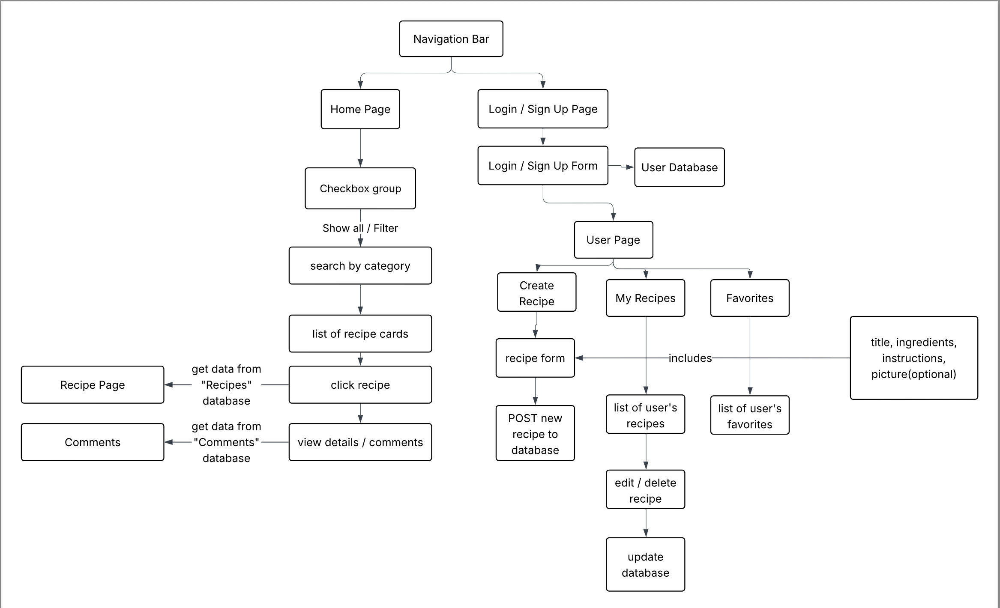
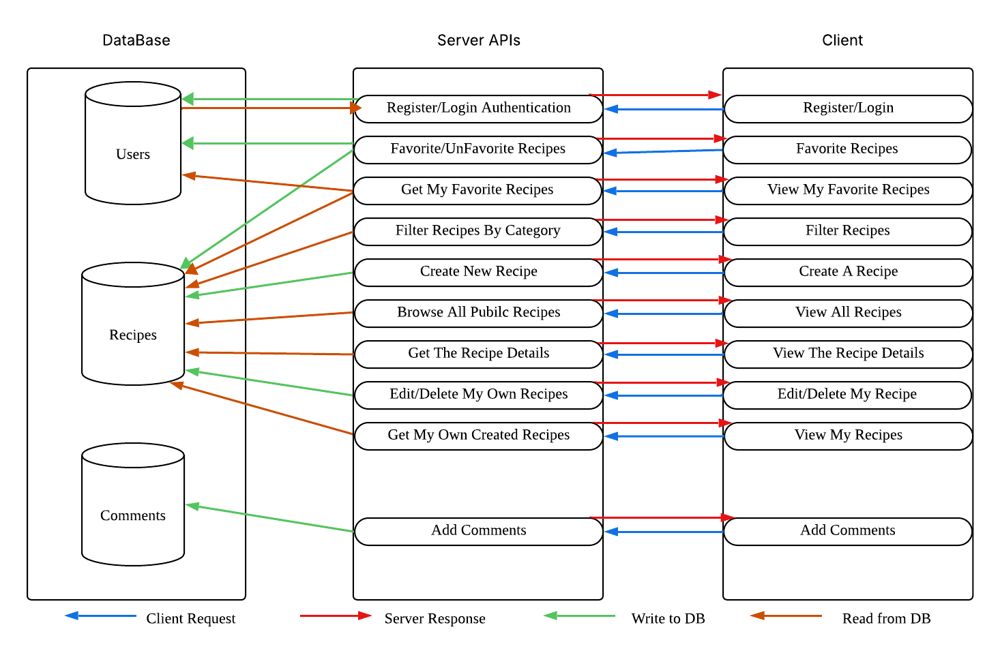

# PrepMate

PrepMate is a full-stack recipe and meal planning web app that helps users organize recipes, manage their own cooking content, and keep everything in one place. The app supports Microsoft sign-in, recipe CRUD workflows, reviews, likes, user profile pages, and image uploads with Azure Blob Storage.

## Live Demo

https://priya-prepmate.onrender.com/

Browse recipes without an account, or sign in with any Microsoft account (work, school, or personal Outlook/Hotmail) to create, like, and review recipes. The site runs on Render's free tier, so the first load after a period of inactivity can take up to a minute.

## Key Features

- Sign in with Microsoft authentication and maintain a session-backed user experience
- Browse all recipes and filter them by category
- Create, edit, and delete recipes you own
- View recipe details with ingredients, instructions, author info, and images
- Like recipes and track liked recipes from your profile
- Leave ratings and written reviews on recipe pages
- Upload recipe images to Azure Blob Storage
- View your created recipes, liked recipes, and past reviews in one dashboard

## Tech Stack

- Frontend: HTML, CSS, Vanilla JavaScript
- Backend: Node.js, Express
- Database: MongoDB with Mongoose
- Authentication: Microsoft identity via `msal-node-wrapper` and `express-session`
- File Storage: Azure Blob Storage
- Deployment: Render

## Architecture



## Data Flow



## API Overview

### Authentication

- `GET /auth/signin` starts the Microsoft sign-in flow
- `GET /auth/signout` signs the user out
- `POST /auth/redirect` handles the auth callback
- `GET /auth/me` returns the current session user

### Recipes

- `GET /recipes` returns all recipes with optional category filtering
- `GET /recipes/:id` returns one recipe and author details
- `POST /recipes` creates a recipe for the logged-in user
- `PUT /recipes/:id` updates a recipe if the user is the owner
- `DELETE /recipes/:id` deletes a recipe if the user is the owner

### Reviews and Likes

- `POST /recipes/:id/reviews` adds a review and rating
- `GET /recipes/:id/reviews` returns reviews for a recipe
- `POST /recipes/:id/like` likes a recipe
- `DELETE /recipes/:id/like` removes a like
- `GET /recipes/:id/liked` checks whether the current user liked a recipe

### User Content

- `GET /users/me/recipes` returns recipes created by the current user
- `GET /users/me/liked` returns recipes liked by the current user
- `GET /users/me/reviews` returns reviews written by the current user

### Uploads

- `POST /api/upload` uploads a recipe image and returns the hosted image URL

## Data Model

PrepMate uses MongoDB collections for users, recipes, comments, and favorites. Recipe ingredients are stored as structured JSON so the app can preserve recipe formatting while supporting future calculations and feature expansion.

Example recipe ingredient structure:

```json
{
  "title": "Chicken Teriyaki Bowl",
  "ingredients": [
    {
      "section": "Chicken",
      "items": [
        {
          "amount": 2,
          "unit": "lbs",
          "name": "boneless skinless chicken thighs",
          "grams": 908
        }
      ]
    }
  ]
}
```

## Local Setup

1. Install dependencies:

```bash
npm install
```

2. Create a `.env` file with the required variables:

```bash
MONGODB_URL=
AZURE_CLIENT_ID=
AZURE_TENANT_ID=common
AZURE_CLIENT_SECRET=
SESSION_SECRET=
APP_BASE_URL=http://localhost:3000
AZURE_STORAGE_CONNECTION_STRING=
AZURE_STORAGE_CONTAINER_NAME=
```

3. Start the development server:

```bash
npm run dev
```

4. Open `http://localhost:3000`

5. Optionally, load example recipes (sign in once first so a user exists):

```bash
npm run seed
```

## Deployment Note

The app is deployed on Render with the same environment variables, with `APP_BASE_URL` set to the deployed URL. The Microsoft sign-in callback is `APP_BASE_URL + /redirect`, and that exact URL must be added as a Web redirect URI in the Azure app registration.
